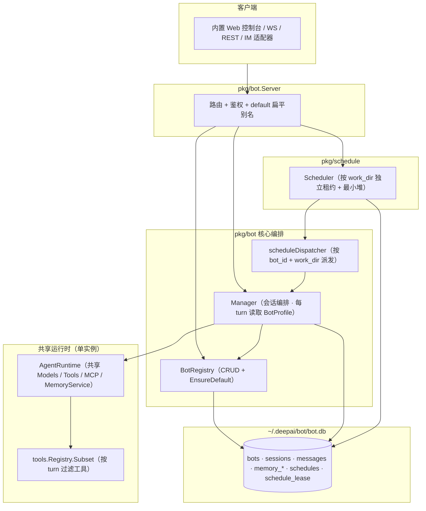

# DeepAI Bot 多 Bot 管理与多 Workdir 调度隔离设计（v2）

> 状态：已落地（含 M1 多 Bot 隔离与 M6 对话式自训练 + 第三方业务 API 连接器）  
> 基线：`feat/bot-m5-channels-governance`  
> 相关文档：[`BOT_DESIGN.md`](BOT_DESIGN.md)、[`BOT_SCHEDULER_DESIGN.md`](BOT_SCHEDULER_DESIGN.md)、[`BOT_NEXT_DESIGN.md`](BOT_NEXT_DESIGN.md)

---

## 1. 背景与核心设计哲学

当前 `deepai-bot` 采用**「出生一致、后天对话训练分化」**（Grok 风格多机器人）架构：
- **出生一致（共享底层大脑）**：所有 Bot 共享同一个 `llm.ModelRegistry` 与 `bot.AgentRuntime`（同一套大模型池、基础工具集与进程基础设施），不为单个 Bot 重复实例化重量级运行时或单独配置大模型 API。
- **后天分化（记忆 + 专属技能 + 业务连接器 + 定时任务）**：每个 Bot 从空白状态起步，随着用户在对话中不断教导业务规则、录入第三方服务密钥、沉淀 API 调用手册和安排定时任务，逐步演化出各自独立的长期记忆（`bot:<id>`）、人格指令（`instructions`）、专属技能目录（`~/.deepai/bot/bots/<id>/skills/`）以及受控的第三方 HTTP 连接器（`APIConnector` + `bot_secrets`）。

在深度审视既有代码与 v1 草案后，v2 做了 4 项关键架构收口，消除实现阶段的潜在冲突：

| 维度 | v1 草案 | v2 定稿（对齐现状代码） |
|------|---------|-------------------------|
| **Runtime 抽象** | `RuntimeFactory` 替换单一 `Runtime` | **保留单一共享 `AgentRuntime`**，通过 `TurnInput` 透传每轮 `BotProfile`（`Instructions` / `MemoryUserID` / `BotToolAllowlist` / `Extensions`），PATCH 或对话自训练后下一 turn 即热生效，无需工厂与缓存失效 |
| **存储实现** | 另写独立 `BotSessionStore`，不复用 `SQLiteSessionStore` | **增量扩展现有 `cmd/deepai-bot/store.go`**（已组合 `*chat.SQLiteSessionStore` 操作 `bot.db`），通过幂等 migration 建 `bots`、`bot_secrets` 表并为 `sessions` 增列 `bot_id` |
| **多 Workdir × 调度器冲突（关键修复）** | 仅一句「#41 跟进」 | **显式解决**：`schedules` 增列 `(bot_id, work_dir)`；`schedule_leases` / `schedule_metas` 升级为**按 `work_dir` 分桶**，防止同机多项目进程互相抢租约或跨目录误触发 |
| **工具白名单** | 推迟到 v1.1 | `pkg/tools.Registry.Subset(allowlist)` 直接支持精确工具名与单后缀 `*` 通配，并与 Scheduler 单任务 `tool_allowlist` 取交集 |

### 1.1 目标边界

| 维度 | 约定 |
|------|------|
| 进程模型 | 一个 `deepai-bot` 进程服务一个 `--workdir`（多实例状态分别写入 `~/.deepai/bot/instances/<hash>.json`） |
| Bot 数量 | 进程内 N 个 Bot（CRUD）+ 不可删的系统内置 `default` |
| 会话归属 | 每条会话必属 `(bot_id, cwd)` |
| 定时任务归属 | 每个 Schedule 必属 `(bot_id, work_dir)`；每 `work_dir` 独立调度租约 |
| 专属技能与密钥 | 专属技能落盘于 `~/.deepai/bot/bots/<bot_id>/skills/<name>/SKILL.md`；第三方 API 密钥经 `pkg/secret.Seal` 加密存入 `bot.db` 的 `bot_secrets` 表 |
| HTTP API | 主路径 `/v1/bots/{bot_id}/{sessions,schedules,secrets}/...`；`default` 保留扁平别名 `/v1/sessions`、`/v1/schedules` |
| 持久化 | 全机单库 `~/.deepai/bot/bot.db`（`bots` + `bot_secrets` + `sessions` + `messages` + `session_locks` + `memories` + `schedules` + `schedule_runs` + `channel_bindings` + `bot_tokens`） |
| 与 CLI | **物理隔离**：CLI 只读 `deepai.db`，bot 只读 `bot.db`；仅只读共享 `config.yaml` / `.env` / `DEEPAI.md` / 技能 / MCP |

---

## 2. 总体架构



核心不变量：
1. **重量级资源全进程共享**：`ModelRegistry`、MCP server 进程、技能发现、`MemoryService`、SQLite 连接池只在 `deepai-bot` 启动时构建一次，不随 Bot 数量线性膨胀。
2. **人格状态每 turn 动态解析**：`Manager.send` 启动一个 turn 时，实时从 `BotRegistry.Get(s.botID)` 拉取最新 `BotProfile`，写入 `TurnInput`。用户在 Web 界面修改了某个 Bot 的 `instructions`、`default_model` 或 `tool_allowlist` 后，无需重启、无需清理缓存，下一轮立即生效。
3. **动态内容不污染前缀缓存**：Bot 的静态 `instructions` 拼入 `systemPrompt`（同一 Bot 内跨轮字节稳定，保留自动前缀缓存）；每分钟变化的当前时间/时区由 `AgentConfig.TurnInjectionExtra` 放入尾部 `turnInjection`（与 `pkg/agent` M4-2 保持一致）。

---

## 3. Bot 数据模型（`BotProfile`）

| 字段 | 类型 | 约束 / 默认 | 说明 |
|------|------|-------------|------|
| `id` | string | 创建后不可改，`^[a-z0-9][a-z0-9_-]{0,31}$` | 保留字 `default` 仅系统启动 `EnsureDefault()` 写入 |
| `name` | string | 必填，1–64 字符 | 展示名称 |
| `title` | string | 可选，≤ 120 字符 | 副标题（例如「Go 代码评审专家」） |
| `description` | string | 可选，≤ 512 字符 | 仅 UI 展示，不进入 prompt |
| `instructions` | string | 可选，**≤ 64 KiB** | Bot 人格指令（Soul），追加到项目 `DEEPAI.md` 之后 |
| `default_model` | string | 可选 | 空 = 沿用 `config.yaml` 默认模型；非空时创建/更新均校验 `Runtime.HasModel` |
| `tool_allowlist` | `[]string` | 可选（空 = 全量） | 允许调用的工具名集合（子代理 `task` 同步继承收敛后的工具集），见 §3.2 |
| `enabled` | bool | 默认 `true` | 停用开关，见 §3.3 |
| `extensions` | `BotExtensions` | 默认 `{}`，序列化 **≤ 64 KiB** | 映射至 `bots.extra_json`：`isolated_prompt`、`disable_self_train`、`connectors`，见 §3.4 |
| `created_at` / `updated_at` | time | 自动 UTC | |

### 3.1 Prompt、技能与记忆隔离规则

| 维度 | 规则 |
|------|------|
| System Prompt 组装（默认 `isolated_prompt=false`） | `基础 Agent 提示` → `全局/工作目录技能描述 + Bot 专属技能描述` → `全局/项目 DEEPAI.md` → `## Bot Instructions\n<bot.instructions>` → `## Bot API Capabilities`（字节稳定） |
| System Prompt 组装（纯净人格 `isolated_prompt=true`） | `基础 Agent 提示` → `仅该 Bot 专属技能描述` → `## Bot Instructions\n<bot.instructions>` → `## Bot API Capabilities`（完全剥离代码仓库 `DEEPAI.md` 与项目技能干扰） |
| Bot 专属技能目录 | `~/.deepai/bot/bots/<bot_id>/skills/<name>/SKILL.md`；每轮通过 `BaseSkills.Clone()` 叠加并重建本轮 `skill` 工具 `enum`，零重启热生效且跨 Bot 物理不可见 |
| 长期记忆 Scope | `MemoryUserID = "bot:" + bot.ID`（写入 `bot.db` 的 `memories` 与 `memory_gate_verdicts` 表；`default` 即现有的 `bot:default`） |
| 会话记忆 Scope | `SessionScope(session_id)`（写入 `bot.db`） |
| 沙箱目录 | `~/.deepai/bot/sandbox/session-<id>`（会话维度，卸载或删除时自动回收） |

### 3.2 `tool_allowlist` 语义

- 空切片（`nil` 或 `[]`）：不限制，开放进程注册表中的全部工具（含 MCP、`schedule`、`http_request`、`save_bot_skill`、`update_bot_persona`）。
- 非空切片：通过 `toolsReg.Subset(allowlist)` 构造只读子视图，仅暴露白名单中的工具（例如自定义业务 Bot 可配置 `["http_request", "skill", "save_bot_skill", "update_bot_persona", "schedule"]` 彻底剥离 `bash` 与本地文件改写权限）。
- **校验策略**：创建/更新 Bot 时，如果 allowlist 里出现当前未注册的工具名，返回 `400 unknown_tool`；支持精确名 + 单后缀 `*` 前缀匹配（如 `mcp__figma__*`）。
- 与 Scheduler P3 单任务白名单叠加时，取**交集**：`effective = intersect(bot.tool_allowlist, schedule.tool_allowlist)`，且子代理（`task`）同样继承收敛后的工具集与当前 Bot 上下文。

### 3.3 `enabled = false` 语义

| 入口 | 行为 |
|------|------|
| `POST /v1/bots/{id}/sessions` | `403 bot_disabled` |
| `POST /v1/bots/{id}/sessions/{sid}/messages`（含 WS `send`） | `403 bot_disabled` |
| 已在运行的 turn | 不强制打断，自然跑完并落盘 |
| `POST /v1/bots/{id}/schedules` | `403 bot_disabled` |
| 已有定时任务到期触发（`Scheduler` → `Fire`） | 不建 turn，Run 直接记 `skipped`（`queued_reason = "bot_disabled"`），不打断其它 Bot 调度 |
| `GET` 会话 / 历史 / Run / `DELETE` | 正常可读可清理 |

### 3.4 `BotExtensions`（`extra_json`）与对话自训练 / 第三方业务 API 接入

为避免污染 `memories`（受单条 500 字符上限与 `pkg/memory/security.go` 密钥拦截规则保护）且无需开放 `bash` 即可安全调用外部 REST/GraphQL 服务，`BotProfile.Extensions`（持久化于 `bots.extra_json`）与 `SecretStore`（持久化于 `bot_secrets`）协同提供三层能力：

```go
type APIConnector struct {
    Name         string            `json:"name"`                    // ^[a-zA-Z0-9][a-zA-Z0-9_-]{0,63}$
    BaseURL      string            `json:"base_url"`                // http(s)://...
    AllowedHosts []string          `json:"allowed_hosts,omitempty"` // 默认自动包含 BaseURL 域名，支持 *.example.com
    Headers      map[string]string `json:"headers,omitempty"`       // 支持 {{secret:NAME}} 占位符
    QueryParams  map[string]string `json:"query_params,omitempty"`  // 支持 {{secret:NAME}} 占位符
    TimeoutSec   int               `json:"timeout_sec,omitempty"`   // 0..300（默认 30s）
}

type BotExtensions struct {
    IsolatedPrompt   bool           `json:"isolated_prompt,omitempty"`
    DisableSelfTrain bool           `json:"disable_self_train,omitempty"`
    Connectors       []APIConnector `json:"connectors,omitempty"`
}
```

1. **按 Bot 隔离的硬件绑定密文仓（`pkg/bot/secrets.go`）**：
   - 表结构：`bot_secrets(bot_id, name, ciphertext, created_at, updated_at, PRIMARY KEY(bot_id, name))`，使用 `pkg/secret.Seal`/`Reveal`（`enc:v1:...` AES-GCM 机器指纹派生密钥）落库。
   - 录入入口：CLI `deepai-bot secret set <NAME> <VALUE> --bot <id>`、REST `PUT /v1/bots/{bot_id}/secrets/{name}`（仅 `admin`）、WS `set_secret`（仅 `admin`）、以及 IM 私聊 `/secret set <NAME> <VALUE>`（仅 `allow_users` 且禁止群聊，明文直接进 `SecretStore`，**永不写入会话消息历史或送入 LLM**）。
   - 模型可见性：`AgentRuntime.RunTurn` 仅向 System Prompt 追加排好序的占位符清单（如 `{{secret:NOTION_TOKEN}}`），模型永远看不到真实密钥值。
2. **受控 HTTP 请求工具 `http_request`（`pkg/bot/connectors.go`）**：
   - 支持指定 `connector` 继承 `base_url`、默认 Header/Query 与 `allowed_hosts`，也可直接请求受控公网 URL。
   - **宿主侧凭据注入与回显脱敏**：发起请求前由宿主将 URL/Header/Query/Body 中的 `{{secret:NAME}}` 展开为真实值；响应体与网络报错返回给模型前，自动将所有已展开密钥全文替换为 `[REDACTED:NAME]`。
   - **安全防线**：携带密钥时强制 `https://` 并拒绝跨域名重定向（防凭据随 302 泄露）；继承 `pkg/netutil.EnvProxyFunc` 代理感知并在解析/拨号阶段拦截环回、私网、链路本地与云元数据地址（SSRF 防护）。
3. **对话式自训练工具（`pkg/bot/training.go`）**：
   - `update_bot_persona`：在交互对话中更新当前 Bot 的 `instructions`、`isolated_prompt` 或增删改 `APIConnector`。
   - `save_bot_skill`：将长篇第三方 API 规范或业务 SOP 写成专属 `~/.deepai/bot/bots/<bot_id>/skills/<name>/SKILL.md`，下一轮立即出现在本 Bot 的 `skill` 工具枚举中。
   - **自训练护栏**：`DisableSelfTrain=true` 时直接从本轮工具集移除上述两个工具；无人值守定时任务/Webhook 运行期间（`tools.IsScheduledRun(ctx)`）硬性拒绝调用；内容若包含该 Bot 已存密钥明文、`enc:v1:` 密文串、Prompt 注入特征或 `` !`command` `` 动态 Shell 块则直接拦截（防止通过自建技能绕过 `bash` 工具白名单）。

---

## 4. 存储与增量迁移（`~/.deepai/bot/bot.db`）

继续沿用单文件 `~/.deepai/bot/bot.db`（WAL、`foreign_keys=ON`、`busy_timeout=5000`、`_txlock=immediate`）。

### 4.1 `bots` 表与 `sessions` 扩展

```sql
CREATE TABLE IF NOT EXISTS bots (
    id                  TEXT PRIMARY KEY,
    name                TEXT NOT NULL,
    title               TEXT NOT NULL DEFAULT '',
    description         TEXT NOT NULL DEFAULT '',
    instructions        TEXT NOT NULL DEFAULT '',
    default_model       TEXT NOT NULL DEFAULT '',
    tool_allowlist_json TEXT NOT NULL DEFAULT '[]',
    enabled             INTEGER NOT NULL DEFAULT 1,
    created_at          INTEGER NOT NULL, -- unix ms
    updated_at          INTEGER NOT NULL,
    extra_json          TEXT NOT NULL DEFAULT '{}'
);

-- 幂等写入系统默认 Bot（已存在则不覆盖用户修改过的 name/instructions）
INSERT OR IGNORE INTO bots (id, name, created_at, updated_at)
VALUES ('default', 'Default', ?, ?);
```

现有 `sessions` 表由 `pkg/chat/session.go` 创建，在 `cmd/deepai-bot/store.go` 启动迁移中以幂等 `ALTER TABLE` 增量扩展（不修改 `pkg/chat` CLI 的 `deepai.db` 行为，或仅作为可选列兼容）：

```sql
-- 仅当 sessions.bot_id 列不存在时执行
ALTER TABLE sessions ADD COLUMN bot_id TEXT NOT NULL DEFAULT 'default';

CREATE INDEX IF NOT EXISTS idx_sessions_bot_cwd_updated
    ON sessions(bot_id, cwd, updated_at DESC);
```

> 说明：SQLite 对 `ALTER TABLE ... ADD COLUMN ... REFERENCES` 在已有表上限制较多，因此 `sessions.bot_id` 完整性由 `Manager` 与 `BotRegistry` 在应用层事务保证（`DELETE bot` 在同一事务中校验或级联删除关联会话）。

### 4.2 多 Workdir × 多 Bot 调度隔离（核心修复）

这是 v1 未覆盖、但多项目共用 `bot.db` 时必然触发的架构缺陷：

**现状问题**：
- `schedules` 无 `work_dir` 与 `bot_id` 列；
- `schedule_lease` / `schedule_meta` 均是 `CHECK (id = 1)` 的全库单行。
- 当用户同时启动 `deepai-bot -w ~/repo-a -addr :8787` 和 `deepai-bot -w ~/repo-b -addr :8788` 时，两个进程共用 `~/.deepai/bot/bot.db`，只有一个进程能拿到 `id = 1` 的租约，另一个变 `standby`，且 Repo A 的调度器会尝试触发 Repo B 创建的任务并在错误目录执行或直接 `dispatch_failed`。

**v2 修复方案（按 `work_dir` 分桶租约）**：

```sql
-- 1. schedules 增量扩展列（历史行 work_dir='' 迁移回填为首次启动该库的 workDir 或显式归属）
ALTER TABLE schedules ADD COLUMN bot_id   TEXT NOT NULL DEFAULT 'default';
ALTER TABLE schedules ADD COLUMN work_dir TEXT NOT NULL DEFAULT '';

CREATE INDEX IF NOT EXISTS idx_schedules_workdir_bot_next
    ON schedules(work_dir, bot_id, state, next_run_at);

-- 2. 租约表升级为按 work_dir 分桶（同一 work_dir 仍严格单活，不同 work_dir 互不干扰）
CREATE TABLE IF NOT EXISTS schedule_leases (
    work_dir   TEXT PRIMARY KEY,
    owner      TEXT NOT NULL,     -- pid@host#start
    expires_at INTEGER NOT NULL
);

CREATE TABLE IF NOT EXISTS schedule_metas (
    work_dir TEXT PRIMARY KEY,
    version  INTEGER NOT NULL DEFAULT 0
);
```

运行语义：
- 每个 `deepai-bot` 进程只查询、调度、持有自己 `work_dir` 的 `schedules`、`schedule_leases` 与 `schedule_metas`；
- 同一 `work_dir` 启动两个 `deepai-bot` 进程时，依然严格遵守「一个 `active`、另一个 `standby` 仅写库并 bump `schedule_metas(work_dir)`」的原语义；
- 不同 `work_dir` 的两个 `deepai-bot` 进程各自持有自己的 `work_dir` 租约，均为 `active`，彼此完全隔离；
- 存量升级兼容：迁移时如发现 `schedules.work_dir = ''` 的旧任务，按 `session_id` 关联 `sessions.cwd` 自动回填 `work_dir`；无会话的孤立旧任务保持 `work_dir = ''`（避免被首个启动的无关目录误认领）并打印 `WARN` 日志列出未归属任务的 `id / name / state` 与显式认领提示。

---

## 5. API 与协议设计

鉴权、Origin/Host 校验、JSON Content-Type 约束完全沿用 [`BOT_DESIGN.md`](BOT_DESIGN.md) §4。

### 5.1 Bot 管理与密钥 REST

| 方法 | 路径 | 说明 |
|------|------|------|
| `GET` | `/v1/bots` | 列出全部 Bot（带统计字段 `session_count`、`active_turns`、`schedule_count`，按当前 `work_dir` 统计） |
| `POST` | `/v1/bots` | 创建 Bot（`id`, `name`, `title?`, `description?`, `instructions?`, `default_model?`, `tool_allowlist?`, `enabled?`, `extensions?`） |
| `GET` | `/v1/bots/{bot_id}` | 获取单个 Bot 详情（含 `extensions`） |
| `PATCH` | `/v1/bots/{bot_id}` | 更新可变字段（不可改 `id`；`default` 允许改 `name`/`instructions`/`default_model`/`tool_allowlist`/`extensions`，禁止设 `enabled=false`） |
| `DELETE` | `/v1/bots/{bot_id}` | 删除 Bot，见 §5.2 强约束规则 |
| `GET` | `/v1/bots/{bot_id}/secrets` | 列出该 Bot 已配置的密钥元数据列表（仅返回 `name`/`created_at`/`updated_at`，永不返回密文或明文） |
| `PUT` | `/v1/bots/{bot_id}/secrets/{name}` | 创建或更新单个加密密钥 `{"value":"..."}`（仅 `admin` 令牌可调用） |
| `DELETE` | `/v1/bots/{bot_id}/secrets/{name}` | 删除单个密钥（仅 `admin` 令牌可调用） |

### 5.2 Bot 删除策略（含跨进程安全保护）

| 条件 | `DELETE /v1/bots/{id}` | `DELETE /v1/bots/{id}?force=1` |
|------|------------------------|---------------------------------|
| `id == "default"` | `405 method_not_allowed` | `405 method_not_allowed` |
| 其它 `deepai-bot` 进程持有该 bot 任一会话的未过期 `session_lock` | `409 session_locked` | `409 session_locked`（不能跨进程强杀他进程中的工具执行） |
| 本进程存在运行中 turn 或活跃 schedule run | `409 busy` | 先标记 `deletingBots` 阻断新请求，取消本进程该 bot 下所有运行中 turn 与活跃 schedule runs，等待落盘（最多 10s），超时则 `409 busy` |
| 存在任意会话或定时任务（含跨其它 `cwd` 的历史会话） | `409 bot_has_sessions`（body 附 `{sessions, schedules}` 计数） | 单事务级联删除：该 bot 下全部 `schedule_runs` → `schedules`（同步递增对应 `schedule_metas` 版本号）→ `channel_bindings` → `bot_secrets` → `messages` → `sessions` → `memories` 与 `memory_gate_verdicts` → `bots` 行，并清理内存会话沙箱与 `~/.deepai/bot/bots/<id>/` 专属技能目录 |

> 最佳实践：日常下线人格优先 `PATCH enabled=false` 保留审计历史；硬删除仅在明确清理时显式使用 `?force=1`。

### 5.3 嵌套路径与扁平别名

| 路径 | 语义 |
|------|------|
| `GET/POST /v1/bots/{bot_id}/sessions` | 列出/创建归属 `(bot_id, work_dir)` 的会话 |
| `GET/PATCH/DELETE /v1/bots/{bot_id}/sessions/{id}` | 必须同时满足 `sessions.bot_id == bot_id && sessions.cwd == work_dir`，否则 `404 not_found` |
| `POST /v1/bots/{bot_id}/sessions/{id}/{messages,cancel,answer}` | 同上 |
| `GET /v1/bots/{bot_id}/sessions/{id}/events` | 同上 |
| `GET/POST /v1/bots/{bot_id}/schedules` | 列出/创建归属 `(bot_id, work_dir)` 的定时任务 |
| `GET/POST /v1/sessions` 与 `/v1/sessions/{id}/...` | **扁平别名**：固定绑定 `bot_id = "default"` + 当前 `work_dir`；用扁平路径访问其它 bot 的 session id 一律返回 **`404 not_found`** |
| `GET/POST /v1/schedules` | 扁平别名：默认列出当前 `work_dir` 全部任务（可带 `?bot_id=...` 过滤），创建时 `bot_id` 缺省为 `"default"` |
| `GET /v1/info` | 新增 `default_bot_id: "default"`、`bots: []BotSummary` |

### 5.4 WebSocket 与事件扩展

- `SessionInfo` 增加 `bot_id`（必填，默认 `"default"`）与 `bot_name`（展示辅助）。
- 全局事件总线（`subscribe "*"`）新增：
  - `bot_created` / `bot_updated` / `bot_deleted`（载荷 `bot`）；
  - `subscribe` 支持可选过滤：`{"op":"subscribe","session_id":"*","bot_id":"reviewer","since":0}`（空表示全部 bot）。
- WS 控制帧新增 ops：`list_bots`、`get_bot`、`create_bot`、`update_bot`、`delete_bot`、`list_secrets`、`set_secret`、`delete_secret`；现有 `list_sessions` / `create_session` / `list_schedules` / `create_schedule` 支持可选 `bot_id`（省略 = `"default"`）。

错误码新增：`unknown_bot`（404）、`bot_disabled`（403）、`bot_has_sessions`（409）、`unknown_tool`（400）、`secret_not_found`（404）。

---

## 6. Go 接口变更（精确到包与文件）

### 6.1 `pkg/tools/registry.go`

```go
// Subset returns a new Registry containing only tools matching allowlist
// (exact name or single trailing "*" prefix such as "mcp__github__*").
// Empty allowlist returns r unchanged.
func (r *Registry) Subset(allowlist []string) *Registry
```

### 6.2 `pkg/bot/bot_registry.go`（新增）

```go
type BotProfile struct {
    ID            string    `json:"id"`
    Name          string    `json:"name"`
    Title         string    `json:"title,omitempty"`
    Description   string    `json:"description,omitempty"`
    Instructions  string    `json:"instructions,omitempty"`
    DefaultModel  string    `json:"default_model,omitempty"`
    ToolAllowlist []string  `json:"tool_allowlist,omitempty"`
    Enabled       bool      `json:"enabled"`
    CreatedAt     time.Time `json:"created_at"`
    UpdatedAt     time.Time `json:"updated_at"`
}

type BotRegistry interface {
    EnsureDefault(ctx context.Context) error
    List(ctx context.Context) ([]BotProfile, error)
    Get(ctx context.Context, id string) (BotProfile, error)
    Create(ctx context.Context, b BotProfile) (BotProfile, error)
    Update(ctx context.Context, b BotProfile) (BotProfile, error)
    Delete(ctx context.Context, id string) error
}
```

`MemoryStore`（`--ephemeral` 与单测）同时实现内存版 `BotRegistry`，内置 `default` Bot。

### 6.3 `pkg/bot/runtime.go` 与 `pkg/bot/agentruntime.go`

不引入 `RuntimeFactory`，直接在 `TurnInput` 增加轻量覆盖字段：

```go
type TurnInput struct {
    // ... 现有字段保持不变 ...
    BotID             string
    SystemPromptExtra string   // BotProfile.Instructions
    MemoryUserID      string   // "bot:" + BotID；空则回退 DefaultMemoryUserID
    ToolAllowlist     []string // 空则全量；非空则 cfg.Tools.Subset(...)
}
```

`agentConversation.RunTurn` 内部：
- `toolsReg := cfg.Tools`；若 `len(in.ToolAllowlist) > 0` 则 `toolsReg = cfg.Tools.Subset(in.ToolAllowlist)`；
- `memUser := cfg.MemoryUserID`；若 `in.MemoryUserID != ""` 则覆盖；
- 若 `in.SystemPromptExtra != ""` 则追加 `## Bot Instructions\n` + `in.SystemPromptExtra`；
- 将 `botID` 写入 `ctx`（`WithBotID(ctx, in.BotID)`），供 `schedule` 工具自动继承当前会话所属 `bot_id`。

### 6.4 `pkg/bot/manager.go` 与 `cmd/deepai-bot/store.go`

- `Store` 接口扩展：
  - `Create` 增加 `BotID`（或通过 `models.CreateOpts` / `bot.CreateSessionRecord` 写入 `sessions.bot_id`）；
  - `ListRecentForBot(botID, cwd string, limit int) ([]models.SessionMeta, error)`；
  - `SessionOwner(id string) (botID, cwd string, err error)`（合并替代单一 `InDir`，一次查询完成 `(bot_id, cwd)` 双校验）；
  - `CountBotSessions(botID string) (int, error)`、`HasExternalLock(botID string, self models.LockOwner) (bool, error)`、`DeleteBotCascade(botID string) error`。
- `Manager`：
  - `session` 结构体新增 `botID string`；
  - `CreateSessionForBot(botID, req)` 与 `SendForBot(botID, sessionID, req)` 均先查 `BotRegistry.Get(botID)`：不存在 → `ErrUnknownBot`，`!Enabled` → `ErrBotDisabled`；
  - 原有 `CreateSession` / `Send` 等方法作为 `botID = "default"` 的薄包装，保持全部已有测试与旧客户端零破坏兼容。

---

## 7. Web 控制台交互（`pkg/bot/web/index.html`）

- 侧栏顶部增加 **Bot 切换器**（下拉/胶囊列表，显示名称与停用状态灰标）+ 「管理 Bot」弹窗（新建 / 编辑 `instructions`、`default_model`、`tool_allowlist` / 启用停用 / 强制删除二次确认）；
- 切换 Bot 后，左侧「会话」与「任务」页签自动过滤到当前 Bot，新建会话/任务默认归属当前 Bot；
- 全局事件订阅接收 `bot_created` / `bot_updated` / `bot_deleted` 实时刷新列表。

---

## 8. 实施与验收清单（已完成）

### PR-A：调度器多 Workdir 隔离 + `tools.Registry.Subset`
- [x] `pkg/tools/registry.go`：`Subset(allowlist)`（含单后缀 `*` 前缀匹配）与单测
- [x] `pkg/schedule`：`schedules` 增 `(bot_id, work_dir)`、`schedule_leases` / `schedule_metas` 按 `work_dir` 分桶与老库自动回填迁移
- [x] 集成测试：同一 SQLite 上两个不同 `work_dir` 的 `Scheduler` 并发启动，各自独立 `active`、互不干扰；同 `work_dir` 双实例仍严格 `active` + `standby`

### PR-B：多 Bot 注册表、API、Manager 集成与 Web UI
- [x] `pkg/bot`：`BotRegistry`（SQLite + 内存版）、`TurnInput` 注入 `BotProfile`（子代理同步继承 `SubagentConstraints`）、`Manager` 校验 `(bot_id, cwd)` 与 `enabled=false`、`DELETE ?force=1` 跨进程锁保护与级联清理（含 schedules、channel_bindings、secrets 与 memory）
- [x] `pkg/bot/server.go` & `ws.go`：`/v1/bots` CRUD、嵌套路径、扁平路径跨 bot 返回 404、`bot_*` 事件与 WS ops
- [x] `pkg/bot/web/index.html`：Bot 切换器与管理弹窗
- [x] 完整测试覆盖：`go test -race ./pkg/bot/... ./pkg/schedule/... ./cmd/deepai-bot/...`

### PR-C：对话式自训练、专属技能隔离与受控第三方业务 API 连接器
- [x] `pkg/bot/secrets.go` & `cmd/deepai-bot/secrets_cmd.go`：`bot_secrets` 机器指纹加密存储、`/v1/bots/{bot_id}/secrets` REST/WS 接口、`deepai-bot secret` CLI 与 IM 私聊 `/secret` 脱敏指令
- [x] `pkg/bot/connectors.go`：`http_request` 工具（连接器继承、`{{secret:NAME}}` 宿主注入、响应/报错自动脱敏、HTTPS/跨域名重定向守卫与 SSRF 防护）
- [x] `pkg/bot/training.go` & `pkg/bot/agentruntime.go`：`save_bot_skill`（拦截明文密钥、Prompt 注入与 `` !`command` `` 动态命令块）+ `update_bot_persona`（定时任务期间禁止自修改）+ 每轮技能 `Clone()` 叠加与 `IsolatedPrompt` 隔离
