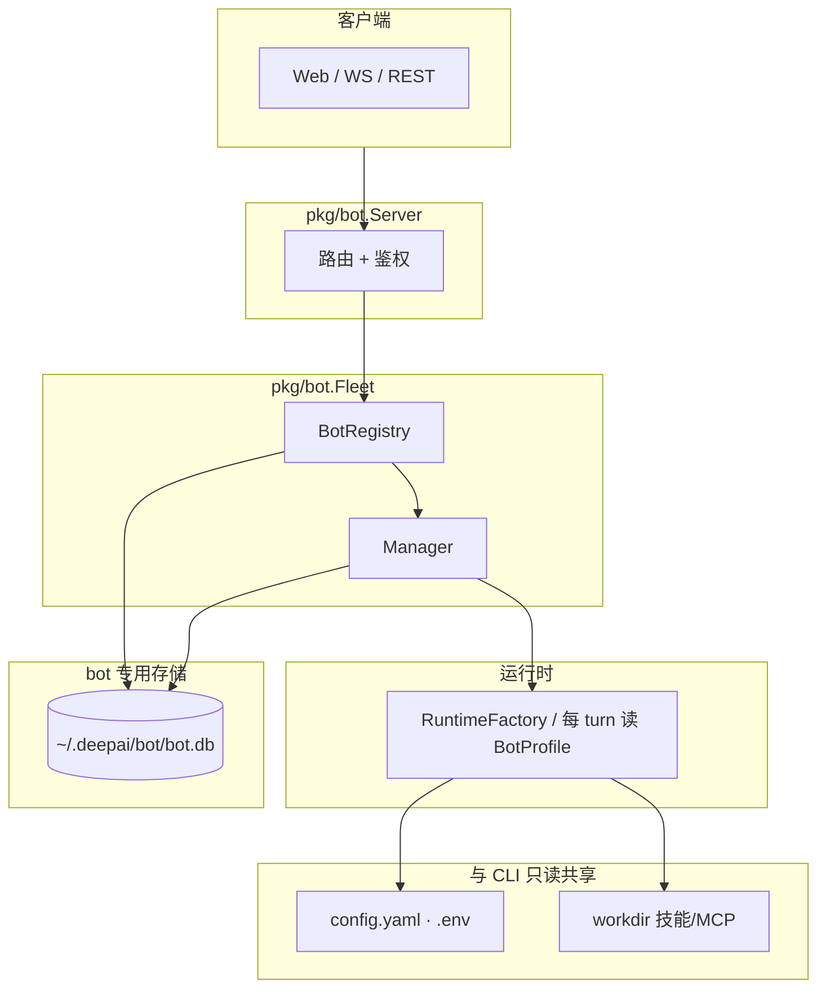

# DeepAI Bot 多 Bot 管理设计（v1）

> 状态：设计草案（仅文档，无实现）  
> 基线：PR #40 / `cursor/deepai-bot-server-56e1`（单进程 `deepai-bot` + `Manager` 多会话）  
> 参考：`docs/BOT_DESIGN.md`（#40 已实现独立 `bot.db` 与 cwd 隔离，见 §5）；本设计在同库上叠加多 `bot_id`；灵感来自 OpenMausBot。

---

## 1. 背景与目标

#40 的 `deepai-bot` 是**常驻 Agent 服务**，但仍是**单人格**：一个进程、一个 `workdir`、一套全局 system prompt，所有会话共用同一默认模型与记忆画像。

本设计在**同一个 `deepai-bot` 进程**内引入**可注册的多个 Bot（人格）**，在 #40 已采用的 **`~/.deepai/bot/bot.db`**（与 CLI 分离）之上扩展 `bots` 表与 `sessions.bot_id`。

### 1.1 成功形态（读完应能开工）

| 维度 | v1 约定 |
|------|---------|
| 进程模型 | 一个 `deepai-bot` 进程、一个 `--workdir`（与 #40 一致） |
| Bot 数量 | 进程内 N 个 Bot（CRUD）+ 不可删的 `default` |
| 会话归属 | 每条 bot 会话**必属**一个 `bot_id`，且 `cwd` = 进程 workdir |
| HTTP API | 主路径 `/v1/bots/{bot_id}/sessions/...`；`default` 保留 #40 扁平别名 |
| 持久化 | **独立** `~/.deepai/bot/bot.db`（bots + sessions + messages + 记忆表） |
| 与 CLI | **不共享**会话/历史/记忆；无 `deepai -r` 续聊 bot 会话 |

### 1.2 与 #40 / CLI 的关系

| 共享（仍同源） | 不共享（各自独立） |
|----------------|-------------------|
| `~/.deepai/config.yaml`、`.env` / API 密钥 | `~/.deepai/deepai.db`（CLI） vs `~/.deepai/bot/bot.db`（bot） |
| 技能 / Claude 插件 / MCP **发现**（按进程 `workdir`） | 会话 transcript、`deepai session list` 中的 bot 行 |
| 进程级工具注册表、`DEEPAI.md` 等**项目级** system 基底 | 长期记忆行：CLI 用 workdir key，bot 用 `bot.db` 内 `bot:<id>` scope，**永不共用行** |
| ReAct 引擎、`pkg/agent` 语义 | `bot.db` 内 **session_lock**（多 bot 进程 / 多客户端互斥，与 CLI 无关） |

单 Bot 阶段记忆 user scope 为 `bot:default`（#40）；多 Bot 实现为每人格 `bot:<id>`，仍只写在 `bot.db`，不与 CLI workdir 记忆混用。

### 1.3 评审收口（PR #42：mibral + Cursor）

独立 `bot.db` **替代**原评审里依赖「CLI 共用 `deepai.db`」的条目：

| 原评审点 | 本设计下的处理 |
|----------|----------------|
| `ALTER sessions ADD bot_id REFERENCES` on `deepai.db` | **不适用**；`bot.db` 建库时自带 `bots` + `sessions.bot_id` FK |
| CLI `bot_id=''` vs 嵌套列表不一致 | **不适用**；CLI 不读 `bot.db` |
| 记忆从 workdir 迁到 `bot:default` / 与 REPL 共享 | **不 remap**；CLI 记忆留 `deepai.db`，bot 只在 `bot.db` 写 `bot:<id>` |
| 跨进程 session 锁 | 仅 `bot.db` 内锁；无 CLI 互斥 |

**仍须遵守（已写入正文）：**

1. **删 Bot**（§6.1）：有会话 → 409；`?force=1` 级联会话 + `SessionScope` + `bot:<id>` 记忆；`default` 不可删。  
2. **扁平 API**（§6.3）：`/v1/sessions/{id}` 仅 `default` + 本进程 `cwd`；其它 bot 的 id → **404**。  
3. **`enabled=false`**（§4.4）：禁新建/发送；在途 turn 跑完；#41 调度 `bot_disabled`。  
4. **Manager**（§7.2）：`RuntimeFactory`；`session.botID`；**每 turn** 应用 profile（PATCH 无需缓存失效）。  
5. **`skill_allowlist`** → **v1.1**（§4.2）。  
6. **`instructions` ≤ 64 KiB**（§4）。  

**`bot.db` 与多进程（Cursor #2）——定稿 (A)：**

- 路径：**一台机器一份** `~/.deepai/bot/bot.db`（不按 workdir 拆文件）。  
- **`bots` 表**：全机共享（各 `deepai-bot` 进程看到同一套人格）。  
- **会话**：`sessions.cwd = 进程 workdir`；`ListRecent*` / `load` / 扁平 `/v1/sessions` **一律** `AND cwd = 当前进程绝对路径`。其它 workdir 写入的同库会话 id，对本进程 **404**（不会用错工具目录）。  

#40 若在 `deepai.db` 上未按 `cwd` 过滤列表，多 Bot 在 **bot.db** 实现中视为必做项（与上同行）。

---

## 2. 核心概念

```
~/.deepai/
 ├── config.yaml、.env          ← CLI 与 bot 共读
 ├── deepai.db                  ← 仅 deepai CLI / REPL
 └── bot/
       ├── bot.db               ← 仅 deepai-bot（bots · 会话 · 记忆）
       ├── bot.json、token、log
       └── sandbox/session-*

deepai-bot 进程（单 workdir）
 ├── BotRegistry（bot.db · bots 表）
 ├── 共享：ModelRegistry · 凭证 · workdir 上技能/MCP 发现
 └── 每个 Bot
       ├── BotProfile（name、instructions、default_model…）
       ├── 派生 prompt / MemoryUserID = "bot:"+id
       └── Sessions[]（bot.db · sessions.bot_id + sessions.cwd）
```

| 概念 | 说明 |
|------|------|
| **Bot** | `bot.db` 里的人格记录；`instructions` 等人格字段只存在此库。 |
| **Session** | 仅存于 `bot.db`；一段对话 + #40 的 turn 语义。 |
| **默认 Bot** | `id=default`；不可 `DELETE`；承接扁平 API 别名。 |
| **CLI 会话** | 仅存于 `deepai.db`；与 bot 无 id 交集约定（各自生成 id）。 |

---

## 3. 总体架构



| 组件 | 变更要点 |
|------|----------|
| `BotRegistry` | 读写 `bots` 表；启动 `EnsureDefault()` |
| `BotSessionStore` | **新** SQLite 实现，路径 `BotDB()`，不复用 `chat.SQLiteSessionStore` 打开 `deepai.db` |
| `MemoryService` | 绑定 **同一 `bot.db`**；与 CLI 记忆表物理隔离 |
| `Manager` | `session` 带 `botID`；`load(id)` 校验 `(bot_id, cwd)`；锁仅 `bot.db` 的 `session_locks` |
| `RuntimeFactory` | `Manager` 用 factory 替代单一 `Runtime`；**每 turn** 从 registry 取最新 `instructions` / `default_model`（见 §7.2） |

事件协议不变；`SessionInfo` 增加 `bot_id`（可选 `bot_name`）。全局 `/v1/events` 的 `bot_id` 过滤可后置。

---

## 4. Bot 配置（v1 字段）

| 字段 | 类型 | 必填 | 说明 |
|------|------|------|------|
| `id` | string | 创建后不可改 | `[a-z0-9_-]{1,32}`；保留字 `default` 仅系统使用 |
| `name` | string | 是 | 展示名 |
| `title` | string | 否 | 副标题（与 session `title` 不同层） |
| `description` | string | 否 | 仅 UI，不进 prompt |
| `instructions` | string | 否 | Soul；**上限 64 KiB** |
| `default_model` | string | 否 | 空 = `config.yaml` 默认别名 |
| `enabled` | bool | 默认 true | 见 §4.4 |
| `created_at` / `updated_at` | time | 自动 | |

### 4.1 workdir（v1）

**所有 Bot 共用进程 `--workdir`**。会话行写入 `sessions.cwd`（绝对路径）；列表与 `load` **必须** `WHERE cwd = 当前进程 workdir`，避免同机多 bot 进程串会话。

### 4.2 技能 / MCP（v1）

| 能力 | v1 |
|------|-----|
| 发现 | 与 REPL 相同，从进程 `workdir` 全量加载 |
| 每 Bot allowlist | **v1.1**（需 per-turn 工具过滤视图） |
| 每 Bot 独立 MCP 连接 | 不做 |

### 4.3 记忆与沙箱

| 资源 | 位置 / 规则 |
|------|-------------|
| Bot 长期记忆 | `bot.db` 内记忆表；`MemoryUserID = "bot:" + bot_id` |
| 会话记忆 | `SessionScope(session_id)`，行在 `bot.db` |
| CLI 长期记忆 | 仍在 `deepai.db`；**无迁移、无 remap、无共享行** |
| 沙箱 | `~/.deepai/bot/sandbox/session-*` |

若存在极早期「bot 会话写在 `deepai.db`」的安装，可用一次性 **导入工具**（实现 PR）迁到 `bot.db`；**不** remap CLI workdir 记忆。

### 4.4 `enabled=false`

| 操作 | 行为 |
|------|------|
| `POST …/sessions` | 403 `bot_disabled` |
| 已有会话 `send` | 403 `bot_disabled` |
| 正在运行的 turn | 跑完为止 |
| 定时任务（#41 跟进） | 跳过，`reason=bot_disabled` |

---

## 5. 持久化（`~/.deepai/bot/bot.db`）

默认路径：`filepath.Join(BotHome(), "bot.db")`（即 `~/.deepai/bot/bot.db`）。DSN  pragma 与 #40 相同习惯：`WAL`、`foreign_keys`、`busy_timeout`、`_txlock=immediate`。

`bot.json` 仍只描述守护进程（pid、addr、**workdir**），不承载 Bot 列表。

### 5.1 库内容

单库容纳：

1. **`bots`** — 人格注册表  
2. **`sessions` / `messages` / `session_locks`** — 与 `pkg/chat` schema **同形**，但仅 bot 使用；`sessions` 含 `bot_id`、`cwd`（无 `source=cli` 行）  
3. **记忆表** — `pkg/memory` 在 bot 进程内 `AutoMigrate(bot.db)`，与 CLI 库分离  

### 5.2 表定义（要点）

```sql
CREATE TABLE IF NOT EXISTS bots (
    id            TEXT PRIMARY KEY,
    name          TEXT NOT NULL,
    title         TEXT NOT NULL DEFAULT '',
    description   TEXT NOT NULL DEFAULT '',
    instructions  TEXT NOT NULL DEFAULT '',
    default_model TEXT NOT NULL DEFAULT '',
    enabled       INTEGER NOT NULL DEFAULT 1,
    created_at    REAL NOT NULL,
    updated_at    REAL NOT NULL,
    extra         TEXT NOT NULL DEFAULT '{}'
);

CREATE TABLE IF NOT EXISTS sessions (
    id          TEXT PRIMARY KEY,
    bot_id      TEXT NOT NULL DEFAULT 'default',
    user_id     TEXT DEFAULT '',
    title       TEXT NOT NULL DEFAULT '',
    model       TEXT DEFAULT '',
    cwd         TEXT NOT NULL DEFAULT '',
    source      TEXT NOT NULL DEFAULT 'bot',
    state       TEXT DEFAULT 'active',
    created_at  REAL NOT NULL,
    updated_at  REAL NOT NULL,
    metadata    TEXT DEFAULT '{}',
    FOREIGN KEY (bot_id) REFERENCES bots(id)
);

CREATE INDEX IF NOT EXISTS idx_sessions_bot_cwd_updated
    ON sessions(bot_id, cwd, updated_at DESC);
-- messages / session_locks / memory_* ：与现有 schema 对齐，建在 bot.db
```

多 Bot 迁移在既有 **`bot.db`** 上增表/增列（`CREATE bots`、`sessions.bot_id` 等），与 #40 schema 兼容；**不**打开 `deepai.db`。

### 5.3 Bot 作用域（方案 A：全局库 + cwd 过滤）

| 实体 | 作用域 | 说明 |
|------|--------|------|
| 文件 `bot.db` | 每用户 home 一份 | `~/.deepai/bot/bot.db`，不随 `-w` 分裂 |
| `bots` 行 | 库内全局 | 仓库 A、仓库 B 两个 bot 进程配置同一 reviewer 人格 |
| `sessions` 行 | `(bot_id, cwd)` | 创建时写入 `cwd`；查询/加载/删除都带 **当前进程 workdir** |

单进程单 workdir 时过滤为恒真；多进程多端口时仍是正确性保证（不用方案 B「每 workdir 独立 bot.db」，避免人格配置分叉）。

---

## 6. API 设计

鉴权与传输同 #40。

### 6.1 Bot CRUD 与删除策略（must-fix #1）

| 方法 | 路径 | 说明 |
|------|------|------|
| GET/POST | `/v1/bots` | 列表 / 创建 |
| GET/PATCH | `/v1/bots/{bot_id}` | 详情 / 更新（含 `enabled`） |
| DELETE | `/v1/bots/{bot_id}` | 见下表 |

**v1 删除规则（定稿）：**

| 条件 | `DELETE`（无 query） | `DELETE ?force=1` |
|------|----------------------|-------------------|
| `bot_id=default` | 405 / 禁止 | 禁止 |
| 存在**任意**会话行（含空闲） | **409 `bot_has_sessions`** | 允许：级联删该 bot 下**本库**全部会话、消息、`SessionScope` 记忆、`bot:<id>` 长期记忆，再删 `bots` 行 |
| 有正在运行的 turn | 409 `busy`（无 force 时） | force 先 `cancel` 再级联（实现顺序：取消 → 等待 turn 结束或超时 → 删除） |

日常「下线人格」：**优先 `PATCH enabled=false`**，保留历史；硬删仅在有意识清理时用 `force=1`。

### 6.2 会话（嵌套路径）

| 方法 | 路径 |
|------|------|
| GET/POST | `/v1/bots/{bot_id}/sessions` |
| 其它 | `/v1/bots/{bot_id}/sessions/{id}/…`（messages、cancel、answer、events） |

`GET /v1/info` 增加 `default_bot_id`、`bots[]`、`db`（`bot.db` 路径，调试用）。

### 6.3 扁平路径与跨 Bot（must-fix #2）

| 路径 | 语义 |
|------|------|
| `GET/POST /v1/sessions` | 等价 `GET/POST /v1/bots/default/sessions`（仅 `default` + **当前 cwd**） |
| `…/v1/sessions/{id}/…` | 仅当该行 `bot_id=default` **且** `cwd=进程 workdir`；否则 **404 `not_found`**（含：用扁平路径访问 `reviewer` 等其它 bot 的 session id） |

嵌套路径：`{bot_id}` 与 `sessions.bot_id` 不一致 → 404。WS `bot_id` 默认 `default`，规则相同。

错误码：`unknown_bot`、`bot_disabled`、`bot_has_sessions`。

---

## 7. 接口层变化（概念）

### 7.1 `BotRegistry` / `BotSessionStore`

```go
// BotDB() → ~/.deepai/bot/bot.db
type BotRegistry interface { List, Get, Create, Update, Delete, EnsureDefault }
type BotSessionStore interface { /* 同 bot.Store，Create 带 BotID + CWD */ }
```

`pkg/bot.Store` 生产实现改为 **只连 bot.db**；`--ephemeral` 仍用 `MemoryStore`，内存里带 `default` bot。

### 7.2 `Manager` 与 Runtime（回应 review #5）

- `Options`：`RuntimeFactory` 替换单一 `Runtime`；`session` 结构增加 `botID`。  
- **每 turn** 读取 `BotProfile`，经 `TurnInput` 传入 soul 后缀与 `MemoryUserID`；已加载会话在 PATCH bot 后**下一 turn 即生效**，无需 Runtime 实例缓存失效。  
- `Store.Load` 返回 `bot_id`；`ListRecentForBot(botID, limit)` 内部 `AND cwd = opts.WorkDir`。

### 7.3 会话锁

仅 **bot 进程内** 多客户端（Web + curl + WS）对 `bot.db` `session_locks` 互斥。**无**与 CLI 的锁交互。

---

## 8. 兼容与迁移（仅 bot 侧）

| 场景 | 行为 |
|------|------|
| #40 客户端只用扁平 `/v1/sessions` | 仅见 **default** bot、**本进程 cwd** 的会话（数据在 `bot.db`） |
| `deepai -r <id>` | **不支持** bot 会话；CLI 只读 `deepai.db` |
| 已有 #40 `bot.db` | 迁移加 `bots` / `bot_id`；历史会话默认 `default` |
| `--ephemeral` | 无 `bot.db` 落盘；单 `default` bot |

---

## 9. 明确不在 v1 范围

Channel、Chief、Computers、人格包导入导出、每 bot token、每 bot workdir、技能 allowlist（v1.1）、CLI↔bot 会话同步、**定时任务**（#41：`schedules.bot_id` 跟进；Bot `force` 删除时删其 schedules）。

---

## 10. 实现检查清单

- [ ] `BotDB()` + schema 迁移（bots、sessions、memory 全在 bot.db）
- [ ] 确认 `NewBotRuntime` 仅写 `bot.db`（#40 已满足；旧 deepai.db 导入为可选）
- [ ] `Fleet`、嵌套 + 扁平 API、扁平跨 bot **404**
- [ ] `DELETE` / `force` / `enabled` 语义与测试
- [ ] `ListRecent` 按 `cwd` 过滤
- [ ] `SessionInfo.bot_id`（及实现 PR 按需：`/v1/events` 过滤）
- [ ] 与 `BOT_DESIGN.md` §5 表述一致（独立 `bot.db`、cwd 过滤）

---

## 11. 小结

v1 = **同进程多 Bot** + **`bot.db` 独享会话与记忆**，与 CLI **配置/技能/MCP 同源、存储分离**。API 以 `/v1/bots/{id}/sessions` 为主；扁平路径绑定 `default` 且禁止跨 bot id。删除 bot 默认禁止（有会话则 409），`force=1` 级联清理；日常用 `enabled=false`。
