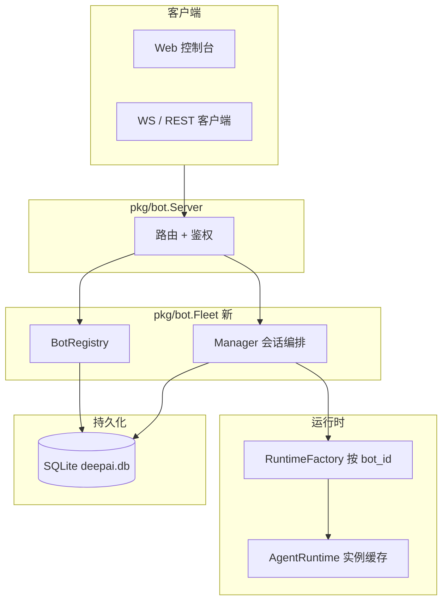

# DeepAI Bot 多 Bot 管理设计（v1）

> 状态：设计草案（仅文档，无实现）  
> 基线：PR #40 / `cursor/deepai-bot-server-56e1`（单进程 `deepai-bot` + `Manager` 多会话）  
> 参考：`docs/BOT_DESIGN.md`；灵感来自 OpenMausBot 的「Bot 为一等公民」，但不照搬其 Electron / 外置 CLI / Assignment 树等形态。

---

## 1. 背景与目标

#40 的 `deepai-bot` 已是**常驻 Agent 服务**，但仍是**单人格、单运行时画像**：一个进程、一个 `workdir`、一套全局 `SystemPrompt`（`DEEPAI.md` + 技能描述）、所有 `source=bot` 的会话共享同一默认模型与记忆 user scope。

本设计在**同一个 `deepai-bot` 进程**内引入**可注册的多个 Bot（人格）**，每个 Bot 拥有：

- 独立展示名、简介、附加 soul / 指令
- 默认模型（须在共享模型注册表内）
- **独立的会话列表**与**隔离的长期记忆命名空间**
- 共享底层凭证（`~/.deepai/config.yaml`、API key）、共享工具/MCP 进程级连接

v1 **刻意保持简单**：不实现渠道/房间、跨 Bot 委派、定时任务绑定、团队包导入导出等（见 §9）。

### 1.1 成功形态（读完应能开工）

| 维度 | v1 约定 |
|------|---------|
| 进程模型 | 仍是一个 `deepai-bot` 进程服务一个项目 `workdir`（与 #40 一致） |
| Bot 数量 | 同一进程内 N 个 Bot 记录，CRUD + 默认 Bot |
| 会话归属 | 每条会话**必属**一个 `bot_id` |
| HTTP API | **以** `/v1/bots/{bot_id}/sessions/...` **为主**；默认 Bot 保留 #40 扁平路径别名 |
| 持久化 | SQLite `bots` 表 + `sessions.bot_id` 列（同一 `deepai.db`） |
| CLI 互通 | `deepai session list` 可列出 bot 会话；元数据中带 `bot_id` |

---

## 2. 核心概念

```
deepai-bot 进程
 ├── BotRegistry（SQLite bots 表）
 │     ├── bot: default   「默认助手」
 │     ├── bot: reviewer  「代码审查」
 │     └── bot: writer    「文档写作」
 ├── 共享：ModelRegistry · ~/.deepai 凭证 · 进程 workdir · MCP 连接池（v1 仍单 workdir 发现技能/插件）
 └── 每个 Bot
       ├── BotProfile（name, title, instructions, default_model, …）
       ├── Runtime 视图（按 Bot 拼 system prompt、默认模型、MemoryUserID）
       └── Sessions[]（SQLite 行带 bot_id；Manager 按 bot 过滤）
```

| 概念 | 说明 |
|------|------|
| **Bot** | 人格/配置记录，不是独立 OS 进程。id 稳定（如 `default`、`reviewer`），供 API 与存储引用。 |
| **Session / Thread** | 仍是一段对话 + turn 语义（#40 不变）。**创建时必须指定 `bot_id`**（路径或 body）。 |
| **默认 Bot** | id 固定为 `default`，迁移与兼容的锚点；不可删除，可改名改指令。 |
| **共享引擎** | `pkg/agent` ReAct、工具实现、模型提供商配置不因 Bot 而复制多份进程。 |

与 OpenMausBot 对齐的**高层次**形状：Bot 为一等记录 → 会话挂在 Bot 下 → 共享引擎与凭证、私有对话与记忆。v1 **不做** Channel、Chief、Computers、人格包导入导出。

---

## 3. 总体架构

在 #40 两层（`Server` → `Manager`）之上增加**薄编排层**，会话 API 先路由到 Bot，再进现有 Manager 逻辑。



| 组件 | 变更要点 |
|------|----------|
| `BotRegistry` | Bot CRUD、校验默认模型、启动时确保 `default` 存在 |
| `RuntimeFactory` | 由 `BotProfile` + 进程级 `AgentRuntimeConfig` **派生**每 Bot 的 `Runtime`（主要是 `SystemPrompt` 后缀、`DefaultModel()`、`MemoryUserID`） |
| `Manager` | 所有会话操作带 `bot_id`：`ListSessions(botID, limit)`、`CreateSession(botID, req)`；**禁止跨 Bot 用会话 id 访问** |
| `Store` | 扩展 `CreateOpts.BotID`、`ListRecentForBot(botID, limit)`；全局 `ListRecent` 仅 CLI/管理用或带过滤 |
| `Server` / `ws.go` | 新路由；WS `op` 增加 `list_bots`、`create_bot` 等（v1 可仅 REST，WS 跟 REST 对齐） |

事件总线、turn 语义、seq 续传、会话锁：**不改协议**，仅在 `SessionInfo` 增加 `bot_id` 字段（可选 `bot_name` 便于 UI）。

---

## 4. Bot 配置（v1 字段）

| 字段 | 类型 | 必填 | 说明 |
|------|------|------|------|
| `id` | string | 创建后不可改 | 小写 `[a-z0-9_-]{1,32}`，进程内唯一 |
| `name` | string | 是 | 短名，UI / 列表展示 |
| `title` | string | 否 | 一行副标题 |
| `description` | string | 否 | 更长说明（仅展示，不进 prompt） |
| `instructions` | string | 否 | **Soul**：追加到进程级 system prompt 之后（Markdown 纯文本） |
| `default_model` | string | 否 | 空 = 进程默认模型别名 |
| `enabled` | bool | 默认 true | 禁用时不可新建会话 |
| `created_at` / `updated_at` | time | 自动 | |

### 4.1 workdir（v1 决策）

**v1：所有 Bot 共用进程启动时的 `--workdir`。**

| 选项 | v1 结论 | 理由 |
|------|---------|------|
| 每 Bot 独立 workdir | **不做** | 需按 Bot 重建 `tools.Registry`、技能发现、Claude 插件根、MCP `cwd`；内存与复杂度接近「多进程多 bot」 |
| 进程单 workdir | **采用** | 与 #40「一个 bot 进程一个项目」一致；多项目仍用**多进程**（不同端口） |
| 会话级 cwd | 不在本设计 | 见 `BOT_DESIGN.md` 路线第 4 点 |

Bot 的「项目感」v1 靠 **instructions + 隔离记忆 + 默认模型** 区分，不靠换目录。

### 4.2 技能 / MCP（v1）

| 能力 | v1 |
|------|-----|
| 技能/MCP 发现 | 仍从进程 `workdir` 全量加载（与 REPL 相同） |
| 每 Bot 子集 | **可选轻量**：`skill_allowlist` / `mcp_allowlist` JSON 数组；空 = 全部。实现成本低则 v1 做，否则记入 v1.1 |
| 每 Bot 独立 MCP 连接 | **不做**（进程级一份） |

### 4.3 记忆与沙箱隔离

| 资源 | 隔离方式 |
|------|----------|
| 会话 transcript | `sessions.id` 不变；`sessions.bot_id` 过滤 |
| 长期记忆 user scope | `MemoryUserID = "bot:" + bot_id`（替换当前按 workdir 哈希的单一 user id） |
| 会话级记忆 | 仍 `SessionScope(session_id)`，天然随会话隔离 |
| 工具沙箱 | `~/.deepai/bot/sandbox/session-*` 路径不变；目录仍按 session，不按 bot 分桶 |

---

## 5. 持久化

继续 **同一 SQLite**（`~/.deepai/deepai.db`），与 CLI 共享连接参数（WAL、`busy_timeout`、`_txlock=immediate`）。

### 5.1 新表 `bots`

```sql
CREATE TABLE IF NOT EXISTS bots (
    id            TEXT PRIMARY KEY,
    name          TEXT NOT NULL,
    title         TEXT NOT NULL DEFAULT '',
    description   TEXT NOT NULL DEFAULT '',
    instructions  TEXT NOT NULL DEFAULT '',
    default_model TEXT NOT NULL DEFAULT '',
    enabled       INTEGER NOT NULL DEFAULT 1,
    created_at    REAL NOT NULL,
    updated_at    REAL NOT NULL,
    extra         TEXT NOT NULL DEFAULT '{}'   -- skill_allowlist 等扩展
);
```

### 5.2 扩展 `sessions`

```sql
ALTER TABLE sessions ADD COLUMN bot_id TEXT NOT NULL DEFAULT 'default'
    REFERENCES bots(id);
CREATE INDEX IF NOT EXISTS idx_sessions_bot_updated
    ON sessions(bot_id, updated_at DESC);
```

- `source = 'bot'` 的会话：**必须有**有效 `bot_id`。
- CLI 会话（`source = 'cli'`）：`bot_id` 保持 `default` 或空串；CLI 不展示 bot 选择时行为与今日一致。

### 5.3 为何不用 `bots.json`

| 方案 | 取舍 |
|------|------|
| `bots.json` | 与 `bot.json`（守护进程 pid）易混淆；难与 `sessions` 做 FK |
| **SQLite 表** | 与会话同库、可事务迁移、与现有 `SessionRepository` 模式一致 |

进程状态文件 `~/.deepai/bot/bot.json` 仍只描述**守护进程**（pid、addr、workdir），不承载 Bot 列表。

---

## 6. API 设计

默认监听与鉴权同 #40。以下路径均需 Bearer token（除 `/healthz`）。

### 6.1 Bot CRUD

| 方法 | 路径 | 说明 |
|------|------|------|
| GET | `/v1/bots` | 列表（含 `default`） |
| POST | `/v1/bots` | 创建 `{"id"?,"name","title"?,"description"?,"instructions"?,"default_model"?}`；省略 `id` 则服务端生成 |
| GET | `/v1/bots/{bot_id}` | 详情 |
| PATCH | `/v1/bots/{bot_id}` | 部分更新（不可改 `id`） |
| DELETE | `/v1/bots/{bot_id}` | 删除；`default` 不可删；有活跃 turn 的会话存在时 409 |

### 6.2 会话（Bot 作用域，主路径）

| 方法 | 路径 | 说明 |
|------|------|------|
| GET | `/v1/bots/{bot_id}/sessions?limit=50` | 仅该 Bot 的会话 |
| POST | `/v1/bots/{bot_id}/sessions` | `{"title"?,"model"?}`；默认模型 = Bot.`default_model` |
| GET/PATCH/DELETE | `/v1/bots/{bot_id}/sessions/{id}` | 同 #40 语义 |
| POST | `…/messages`、`…/cancel`、`…/answer` | 不变 |
| GET | `…/events` | 不变 |

`GET /v1/info` 扩展：

```json
{
  "name": "deepai-bot",
  "workdir": "/path/to/project",
  "default_bot_id": "default",
  "bots": [{"id": "default", "name": "默认助手"}],
  "models": [ … ]
}
```

### 6.3 与 #40 扁平 API 的取舍

#40 已有 `/v1/sessions`（全局列表、无 bot 维度）。多 Bot 后全局列表语义模糊，故：

| 策略 | 说明 |
|------|------|
| **主 API** | `/v1/bots/{bot_id}/sessions/...`（推荐新客户端使用） |
| **兼容别名** | 保留 `/v1/sessions/...`，等价于 **`bot_id=default`**；`POST /v1/sessions` 创建的会话归属 `default` |
| **弃用时间线** | 控制台与文档先双写；非 default Bot 只能通过嵌套路径访问 |

WebSocket：`list_sessions` / `create_session` 增加可选字段 `bot_id`（默认 `default`）；嵌套语义与 REST 一致。

错误码新增：`unknown_bot`(404)、`bot_disabled`(403)。

---

## 7. 接口层变化（概念，非完整代码）

### 7.1 `BotRegistry`

```go
type BotProfile struct { ID, Name, Title, Description, Instructions, DefaultModel string; Enabled bool; … }

type BotRegistry interface {
    List() ([]BotProfile, error)
    Get(id string) (BotProfile, error)
    Create(BotProfile) (BotProfile, error)
    Update(id string, patch BotProfile) (BotProfile, error)
    Delete(id string) error
    EnsureDefault() error
}
```

### 7.2 `Runtime` / `RuntimeFactory`

#40 的 `Runtime` 接口可保持不变；新增工厂：

```go
type RuntimeFactory interface {
    ForBot(botID string) (Runtime, error) // 缓存 + BotProfile 派生
}
```

派生规则（示意）：

- `SystemPrompt = baseSystemPrompt + "\n\n# Bot: " + name + "\n" + instructions`
- `DefaultModel() = bot.default_model || registry.DefaultName()`
- 构造 `agent.Agent` 时 `MemoryUserID = "bot:" + botID`

### 7.3 `Store` 扩展

在 `pkg/bot.Store` / `models.CreateOpts` 上增加 `BotID string`。

```go
ListRecentForBot(botID string, limit int) ([]models.SessionMeta, error)
```

SQLite 实现：`WHERE source='bot' AND bot_id=? ORDER BY updated_at DESC`。

`Manager.CreateSession` 流程：`ResolveBot` → `runtime.ForBot` → `Store.Create(..., BotID)`。

### 7.4 `Fleet` 与 `Manager` 关系（推荐 v1 结构）

```go
type Fleet struct {
    registry BotRegistry
    factory  RuntimeFactory
    mgr      *Manager // 单一 Manager，内部按 bot_id 校验
}
```

不采用「每 Bot 一个 Manager 进程内实例」—— 会话 id 全局唯一、锁与 janitor 仍集中，只需在 `load(id)` 时校验 `session.bot_id` 与请求 Bot 一致。

---

## 8. 兼容与迁移

### 8.1 首次升级（有历史 bot 会话）

1. 迁移脚本：`CREATE TABLE bots` → `INSERT default` → `ALTER sessions ADD bot_id`。
2. 将所有 `source='bot'` 且 `bot_id` 为空的行设为 `default`。
3. `BotRegistry.EnsureDefault()` 在 `deepai-bot` 启动时幂等执行。

### 8.2 行为保证

| 场景 | 行为 |
|------|------|
| 旧客户端只调 `/v1/sessions` | 仅看到/操作 **default** Bot 的会话 |
| 旧 bot 会话 id | 不变；归属 `default` |
| CLI `deepai -r <id>` | 仍可恢复；可选后续在 TUI 显示 `bot_id` |
| `--ephemeral` | 内存 Store 同样带内存 `BotRegistry`，仅 `default` 一个 Bot |

### 8.3 与「多 workdir = 多进程」并存

| 需求 | 做法 |
|------|------|
| 两个仓库两个助手 | 两个 `deepai-bot`（不同 `-w`、端口），**各自**进程内仍可多 Bot |
| 同仓库多人格 | 单进程多 Bot（本设计） |

---

## 9. 明确不在 v1 范围

以下记入「后续」，本 PR **不写实现**：

| 项 | 说明 |
|----|------|
| Channel / Room / IM 线程映射 | 仍是 `BOT_DESIGN.md` 路线第 2 点 |
| Chief of Staff / 跨 Bot 委派、决策模型 | OpenMausBot Chief/Jev 类能力 |
| Computers（Boat/VM）、远程执行面 | 外置运行时 |
| 人格包导入导出（无密钥/无历史） | 团队共享 Bot 模板 |
| 每 Bot / 每用户独立 token | 仍是单 token 管整个进程 |
| 每 Bot 独立 workdir 与工具注册表 | 见 §4.1 |
| **定时任务** | PR #41 `docs/BOT_SCHEDULER_DESIGN.md`：v1 调度器可先不绑 `bot_id`；**跟进**应为 `schedules.bot_id`，触发 turn 时走 `/v1/bots/{id}/sessions/...` |
| 多用户 `user_id` 列与会话授权 | `sessions.user_id` 仍留空或全局单用户 |

---

## 10. 客户端与控制台（提示）

v1 实现阶段建议：

1. Web 控制台左侧：**Bot 切换器** → 再列会话。
2. 创建会话 API 使用嵌套路径，避免误把 reviewer 会话建到 default。
3. `SessionInfo.bot_id` 展示在会话详情页。

---

## 11. 实现检查清单（给下一 PR）

- [ ] SQLite 迁移 + `BotRegistry` SQLite 实现
- [ ] `Fleet` 装配于 `cmd/deepai-bot` / `NewBotRuntime`
- [ ] REST + WS 路由与兼容别名
- [ ] `Manager` bot_id 校验与 `ListRecentForBot`
- [ ] `MemoryUserID` 按 bot 隔离
- [ ] 测试：default 兼容、跨 bot 访问 404、CRUD、删除有会话的 bot
- [ ] 更新 `docs/BOT_DESIGN.md` 架构图（Fleet 一层）—— 可在实现 PR 做

---

## 12. 小结

v1 多 Bot 是 **同一 deepai-bot 进程内的配置与人格分轨**：SQLite 登记 Bot、会话挂 `bot_id`、API 以 `/v1/bots/{id}/sessions` 为主、默认 Bot 承接 #40 扁平路径。共享 ReAct 引擎与凭证，靠 instructions / 默认模型 / `bot:` 记忆命名空间区分角色；workdir 仍进程级，复杂隔离继续用多进程或多阶段演进。
